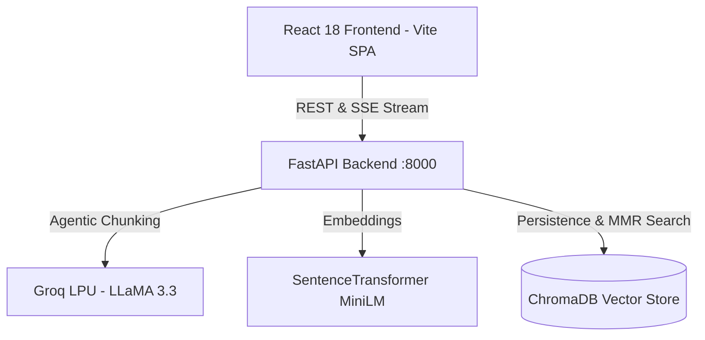

# 🚀 AgenticRAG-ChatBot Deployment Guide

This guide covers how to run and deploy the decoupled **FastAPI Backend** and **React (Vite) Frontend**.

---

## 🏗️ Architecture Overview



---

## ⚡ Option 1: Quick Local Development

### 1. Backend Setup (FastAPI)

```bash
cd backend

# Create & activate a virtual environment
python -m venv venv
# Windows:
venv\Scripts\activate
# Linux/macOS:
source venv/bin/activate

# Install dependencies
pip install -r requirements.txt

# Create .env and set your Groq API key
cp .env.example .env
# Edit .env and paste your GROQ_API_KEY=gsk_...

# Run the FastAPI server
uvicorn app.main:app --reload --port 8000
```
- Swagger API Docs: `http://localhost:8000/docs`
- Health Check: `http://localhost:8000/api/health`

### 2. Frontend Setup (React + Vite)

```bash
cd frontend

# Install dependencies
npm install

# Run Vite dev server
npm run dev
```
- Open `http://localhost:5173` in your browser.
- Vite automatically proxies `/api` calls to `http://localhost:8000`.

---

## 🐳 Option 2: Docker Compose (Recommended for Production / VPS)

Run the full stack with a single command:

```bash
# 1. Copy environment template
cp .env.example .env

# 2. Add your Groq API key in .env
# GROQ_API_KEY=gsk_...

# 3. Build & start containers
docker compose up --build -d
```

- **Frontend:** `http://localhost:3000` (Nginx serving React SPA with automatic `/api` proxying)
- **Backend API:** `http://localhost:8000`
- **Data Persistence:** ChromaDB data is automatically persisted in the `chroma_data` Docker volume.

To stop the services:
```bash
docker compose down
```

---

## ☁️ Option 3: Cloud Deployment (Vercel + Render / Railway)

### A. Deploy Backend to Render (Free / Starter)

1. Push your repository to GitHub.
2. Log in to [Render](https://render.com) and click **New + Web Service**.
3. Connect your GitHub repository.
4. Configure service settings:
   - **Root Directory:** `backend`
   - **Runtime:** `Python 3` (or choose `Docker`)
   - **Build Command:** `pip install -r requirements.txt`
   - **Start Command:** `uvicorn app.main:app --host 0.0.0.0 --port $PORT`
5. Under **Environment Variables**, add:
   - `GROQ_API_KEY` = your Groq API key
   - `LLM_MODEL` = `llama-3.3-70b-versatile`
6. Click **Deploy Web Service**.
7. Copy your deployed backend URL (e.g., `https://agentic-rag-backend.onrender.com`).

### B. Deploy Frontend to Vercel (Free)

1. Log in to [Vercel](https://vercel.com) and click **Add New > Project**.
2. Select your repository.
3. Configure project settings:
   - **Framework Preset:** `Vite`
   - **Root Directory:** `frontend`
4. Under **Environment Variables**, add:
   - `VITE_API_BASE_URL` = `https://your-backend-app.onrender.com/api`
5. Click **Deploy**.
6. Your React frontend is now live on a global CDN!

---

## ☁️ Option 4: Deploying to Railway

1. Install Railway CLI or connect GitHub on [Railway.app](https://railway.app).
2. Create a project from your repo.
3. Add service 1 (Backend):
   - Root directory: `/backend`
   - Set variables: `GROQ_API_KEY`
4. Add service 2 (Frontend):
   - Root directory: `/frontend`
   - Set variable: `VITE_API_BASE_URL` = `${{Backend.RAILWAY_PUBLIC_DOMAIN}}/api`
5. Both services will deploy automatically with persistent volumes.

---

## 📋 API Endpoints Reference

| Method | Endpoint | Description |
|---|---|---|
| `GET` | `/api/health/` | Health check & vector database chunk stats |
| `GET` | `/api/documents/` | List all indexed documents |
| `POST` | `/api/documents/upload` | Upload & index PDF, TXT, MD, DOCX files |
| `POST` | `/api/documents/text` | Add raw text snippet to knowledge base |
| `DELETE` | `/api/documents/{name}` | Delete document and remove vector embeddings |
| `DELETE` | `/api/documents/` | Clear entire knowledge base |
| `POST` | `/api/chat/` | Standard JSON MMR retrieval + Groq answer |
| `POST` | `/api/chat/stream` | Real-time SSE streaming answer with citations |
| `GET` | `/api/config/` | View current models & retrieval parameters |
| `POST` | `/api/config/` | Update Groq API key & parameters dynamically |

---

## 🔧 Environment Variables Summary

| Variable | Required | Default | Description |
|---|---|---|---|
| `GROQ_API_KEY` | **Yes** | `""` | Groq Cloud API Key for LLaMA 3.3 |
| `LLM_MODEL` | No | `llama-3.3-70b-versatile` | LLM model for chunking & answers |
| `EMBED_MODEL` | No | `all-MiniLM-L6-v2` | Hugging Face embedding model |
| `CHROMA_PERSIST_DIR` | No | `./chroma_db` | Persistent vector store directory |
| `PORT` | No | `8000` | Port for FastAPI server |
